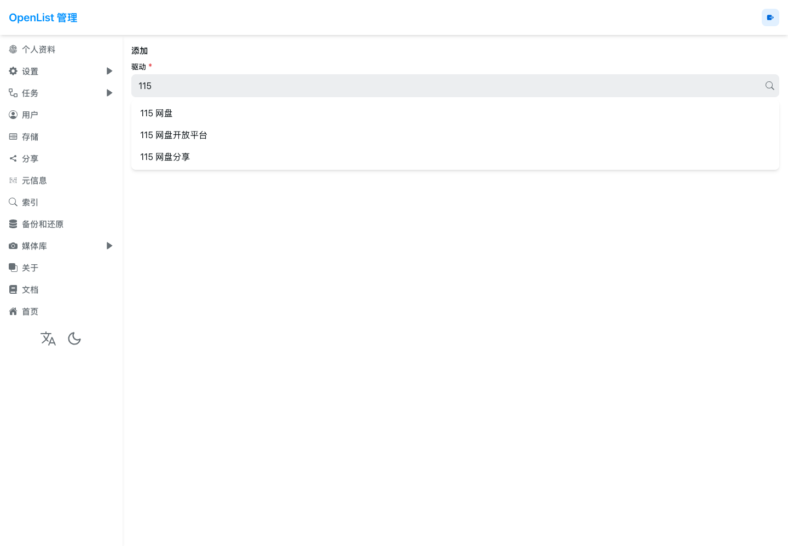
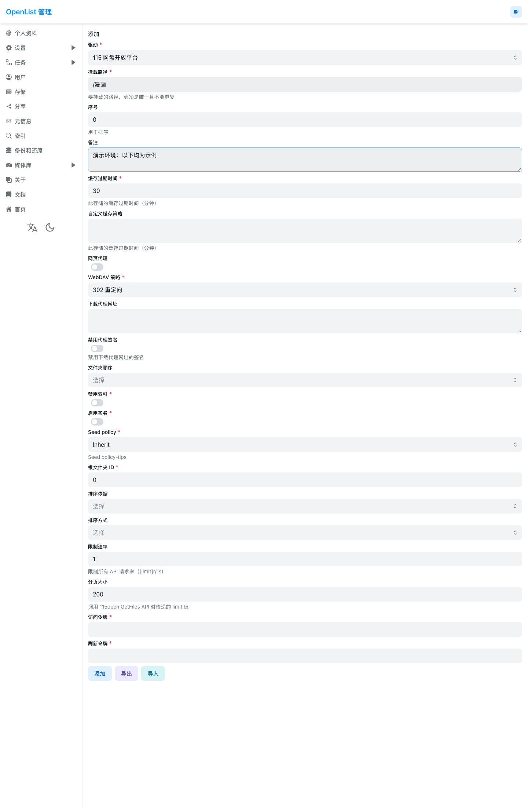

# 115 云盘漫画阅读服务

在 Mac 上使用 OrbStack 和 Docker Compose，将 115 云盘中的漫画接入 Suwayomi 本地源。OpenList 负责连接 115，Rclone 通过只读 NFS 提供目录，Suwayomi 负责浏览和阅读；独立的索引容器定期更新作品映射。

```text
115 云盘 → OpenList → Rclone / NFS → Suwayomi 本地源
                              ↘ 定时索引容器
```

> 仓库只包含部署代码和演示截图，不包含网盘令牌、账号、漫画、书架数据库或封面。本文的截图来自独立演示环境，所有授权字段为空。

## 准备

- macOS，已安装并启动 [OrbStack](https://orbstack.dev/)；其他 Docker 环境尚未做完整验证。
- Docker Compose、Python 3.9 或更新版、JDK 17 或更新版（需要 `java` 和 `javac`）。Mac 上可使用 `brew install openjdk@17`；如果不在 PATH，可设置 `JDK_BIN` 为其 `bin` 目录。
- 115 账号及准备好的漫画目录；运行时需能访问 OpenList、115、Docker 镜像仓库和 GitHub 发行版。
- 为首次下载约 174 MiB 的官方 JAR、生成补丁及运行容器预留空间与内存。Java 堆上限为 1 GiB，Rclone 使用最多 1 GiB 的临时文件系统，实际内存压力与漫画及并发量有关。

## 1. 初始化本机配置

在项目目录执行：

```sh
./setup.sh
./manga.sh start-openlist
```

初始化会生成随机 OpenList 管理员密码和 Rclone 配置；如果本地配置已存在，脚本会停止并保留原文件。需要登录 OpenList 时，在**自己的终端**运行 `./manga.sh password` 查看密码。此密码、项目内 `.env` 和 `config/` 都应保密，勿放入截图或 Issue。

## 2. 在 OpenList 中连接 115

1. 打开本机 [OpenList](http://127.0.0.1:5244)，以 `admin` 和刚生成的密码登录。进入“存储”，添加存储，驱动选择 **115 网盘开放平台**。

   

2. 将**挂载路径**设为 `/漫画`。根文件夹 ID 填写自己 115 漫画目录的 ID；图中 `0` 只是默认示例，指网盘根目录，并不代表你的漫画目录。

   

3. 按 [OpenList 官方指南](https://github.com/OpenListTeam/OpenList-Docs/blob/main/pages/guide/drivers/115_open.md)获取访问令牌和刷新令牌。在 [OpenList Token](https://api.oplist.org/) 的网盘服务中选择 **115 网盘 - 验证登录 (OAuth App)**，使用 OpenList 提供的参数，完成 115 登录授权。页面的“扫码登录”是另一个选项；115 验证登录弹出的登录页面仍可按页面提示扫码。
4. 将两个令牌仅粘贴到自己本机 OpenList 的对应字段，保存并确认存储状态正常、能够列出目录。不要分享令牌、授权回调地址或包含令牌的截图。

Rclone 的 WebDAV 配置在 `./setup.sh` 中自动生成，使用容器内的 `openlist` 服务名。Rclone 的密码混淆可逆，配置文件仍是敏感信息。115 授权可能包含写入、删除等权限，具体以授权页为准；本项目通过 Rclone **只读**访问，并不改变 115 授权范围。

## 3. 启动并阅读

```sh
./manga.sh start
```

首次启动会从 Suwayomi 官方发行版下载固定版本 JAR、校验 SHA-256，并在本机编译补丁后构建镜像；JAR 和生成文件不会提交到 Git。打开 [Suwayomi](http://127.0.0.1:4567)，进入 **Browse → Local source**，搜索作品并打开卷；可按需加入 Library。

```sh
./manga.sh status              # 查看容器和索引健康状态
./manga.sh refresh             # 手动刷新目录缓存和本地索引
./manga.sh logs indexer        # 查看自动扫描日志
./manga.sh logs openlist       # 查看 OpenList 日志
./manga.sh stop                # 停止容器，保留数据
```

公开日志之前，请移除个人路径、账号、令牌及带签名的 URL。

## 推荐目录结构

在 OpenList 挂载的漫画目录中整理成：

```text
漫画目录/
├── 作品 A/
│   ├── 第01卷.cbz
│   └── 第02卷.zip
└── 作品 B/
    ├── 第01章/
    │   ├── 001.jpg
    │   └── 002.jpg
    └── 第02章/
        └── 001.jpg
```

索引器会保守识别部分解压后多出的一层或多层单目录包装；无法判断的结构保持原样。索引只新增本机映射，不删除旧映射，也不覆盖已有文件。根目录的 RAR/CBR 会跳过，需要先在云端解压并整理为作品目录。Suwayomi 官方支持图片目录、ZIP/CBZ、RAR/CBR 和 EPUB，但 RAR5 暂不受支持；加密压缩包或异常格式应先解密、解压或转换，详见 [本地源说明](https://github.com/Suwayomi/Suwayomi-Server/wiki/Local-Source)。

## 定时索引与缓存

索引容器启动后扫描一次，此后每轮成功完成约一小时后再扫描。失败时逐步退避重试，最多一小时。容器没有 Docker socket 或容器网络，云盘只读；Mac 和 OrbStack 必须运行。Rclone 与 OpenList 有目录缓存，新内容可能晚于下一次扫描出现。已有作品新增卷后，如章节列表未更新，可在作品页面刷新章节。

Rclone 正文缓存使用容器内 `tmpfs`，不作为持久正文卷保存；浏览器、虚拟机和操作系统的缓存或交换空间由各自管理，不能据此保证所有读取都完全不写磁盘。封面、书架和进度保存在 `data/suwayomi/`；OpenList 授权信息保存在 `data/openlist/`。Rclone 的 256 MiB 缓存大小是回收目标，打开中的文件可能超过该目标；参见 [Rclone NFS 文档](https://rclone.org/commands/rclone_serve_nfs/)。

## 排障

- 本地源没有作品：先确认 OpenList 存储正常，再运行 `./manga.sh refresh` 并刷新本地源；检查目录结构及根目录 RAR 限制。
- 页面加载失败：查看 `./manga.sh logs suwayomi` 和 `./manga.sh logs rclone`，检查 115 授权、云盘文件格式和网络。首次读取大卷可能较慢；同一 RAR 卷的图片请求可能排队，降低阅读器预载数量可能有帮助。
- 自动索引失败：查看 `./manga.sh status` 和 `./manga.sh logs indexer`。健康状态仅反映扫描情况，不等于所有漫画都可读；此容器不主动发送通知。
- 端口或 Docker 网段冲突：在 `.env` 中设置 `OPENLIST_PORT`、`SUWAYOMI_PORT`，或同时设置匹配的 `MANGA_SUBNET` 和 `RCLONE_NFS_IP`。更改网段时，现有 Docker NFS 卷可能仍记住旧地址：先运行 `docker compose down`（不要加 `-v`），用 `docker volume inspect` 确认项目的 `cloud_manga` 卷是 NFS 挂载配置，再仅删除该卷并重新运行 `./manga.sh start`。默认项目名时，卷名为 `manga-reader_cloud_manga`；自定义项目名时需先核实卷名。不要删除其他卷或 `data/` 目录。`.env` 含密码，不要提交或分享。
- 凭据过期：按官方流程重新授权；刷新令牌可能轮换，不要反复导入旧备份。

## 验证边界与许可

本仓库补丁针对固定的 Suwayomi v2.4.2366，用于修复本地 RAR 单页读取阻塞和章节页流缓存缺失。它不是上游官方补丁，单页 RAR 内存解码有 128 MiB 限制；真实压缩包的格式、网络和阅读器行为仍需自行验证。部署链路已在 OrbStack 的隔离环境中使用合成 ZIP 和本地 OpenList 存储验证；真实 115 OAuth 和不同平台的兼容性并未在该隔离环境中验证。

许可、上游项目及第三方组件说明见 [LICENSE-NOTICE.md](LICENSE-NOTICE.md)。
